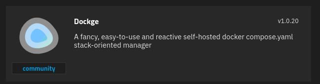

# What is Dockge?

Dockge is a self-hosted Docker stack manager developed by the same person behind the popular software Uptime Kuma.

This software allows you to manage multiple Docker compose files from a single, easy-to-use interface. It is similar to the stack system Portainer implements but cleaner and simpler to use.

> [!NOTE]
> Dockge has not had a new release since 1.5.0 (March 2025), although the repo still gets occasional commits. If you want an actively developed alternative, take a look at [Arcane](/arcane).

# 1 · Deploy Dockge
:::block-tabs
::block-tab{label="TrueNAS" icon="simple-icons:truenas"}


1. Change the **WebUI Port** to **5001** since that is the default normally used by Dockge.
1. Change the **Dockge Stacks Storage** to **Hostpath** and make sure the dataset has permissions set for the **apps** user. 

::

::block-tab{label="Docker" icon="simple-icons:docker"}
> [!WARNING]
> Note that Docker has to be installed before you can follow these steps!


### Docker Run

```bash
# Create directories that store your stacks and stores Dockge's stack
mkdir -p /opt/stacks /opt/dockge
cd /opt/dockge

# Download the compose.yaml
curl https://raw.githubusercontent.com/louislam/dockge/master/compose.yaml --output compose.yaml

# Start the server
docker compose up -d

# If you are using docker-compose V1 or Podman
# docker-compose up -d
```

### Docker Compose

```yaml
services:
 dockge:
   image: louislam/dockge:1
   restart: unless-stopped
   container_name: dockge
   ports:
     - 5001:5001
   volumes:
     - /var/run/docker.sock:/var/run/docker.sock
     - /mnt/tank/configs/dockge:/app/data
     - /mnt/tank/stacks:/mnt/tank/stacks
   environment:
     - DOCKGE_STACKS_DIR=/mnt/tank/stacks
     - DOCKGE_ENABLE_CONSOLE=true
```

::

:::

# 2 · Logging In

Navigate to http://{serverIP}:5001 and create a user and password to login.

# :logos:youtube-icon: 3 · Video

::block-youtube{url="https://youtu.be/mVbi6xkM-rk"}
::
