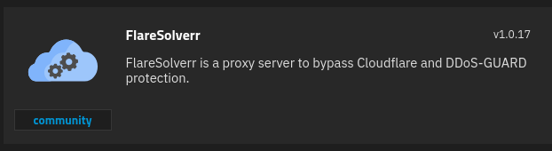

# What is Flaresolverr?
FlareSolverr is a proxy server to bypass Cloudflare and DDoS-GUARD protection.

# 1 · Deploy Flaresolverr
:::block-tabs
::block-tab{label="TrueNAS" icon="simple-icons:truenas"}


Change the **WebUI Port** to **8191** since that is what is used in all the default documentation.

> [!NOTE]
> You do not need a host path volume for this container

::

::block-tab{label="Docker Compose" icon="simple-icons:docker"}
```yaml
services:
  flaresolverr:
    image: ghcr.io/flaresolverr/flaresolverr:latest
    container_name: flaresolverr
    environment:
      - LOG_LEVEL=info
      - LOG_HTML=false
      - CAPTCHA_SOLVER=none
      - TZ=America/New_York
    ports:
      - 8191:8191
    restart: unless-stopped
```

::

:::

# :logos:youtube-icon: 2 · Video

::block-youtube{url="https://youtu.be/sUMT0PTll_M"}
::
