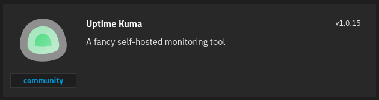

# What is Uptime Kuma?

Uptime Kuma is a web monitor tool that supports various monitors such as HTTP, DNS, MySQL, Postgres, Docker, and more.

# 1 · Deploy Uptime Kuma
:::block-tabs
::block-tab{label="Docker Compose" icon="simple-icons:docker"}
```yaml
services:
  uptime-kuma:
    image: louislam/uptime-kuma:2
    container_name: kuma
    volumes:
      - /mnt/tank/configs/kuma:/app/data
      - /var/run/docker.sock:/var/run/docker.sock
    ports:
      - 3001:3001
    restart: unless-stopped
```

> [!WARNING]
> **Upgrading from 1.x?** The `latest` tag still points to the old 1.x line, so switching to `:2` is a major upgrade. On first start, 2.x runs a one-time database migration that can take minutes to hours. Stop the container and back up `/mnt/tank/configs/kuma` first, then let the migration finish without interrupting it (watch `docker logs -f kuma`). See the [v1 to v2 migration guide](https://github.com/louislam/uptime-kuma/wiki/Migration-From-v1-To-v2).

::

::block-tab{label="TrueNAS" icon="simple-icons:truenas"}


- The **App Config Storage** *Type of Storage* should be set to **Host Path** as described in [Folder Structure](/Folder-Structure).

::

:::

# 2 · Uptime Kuma Configuration

I'm not going to include a guide here on how to use Uptime Kuma. Its pretty straight forward and I think Christian did a great job here. 

::block-youtube{url="https://youtu.be/tIazVdhsSqQ?si=u4A4-4AUqToEWCEl&t=198"}
::

# :logos:youtube-icon: YouTube Walkthrough

::block-youtube{url="https://youtu.be/7VrU_zNrzqo"}
::
