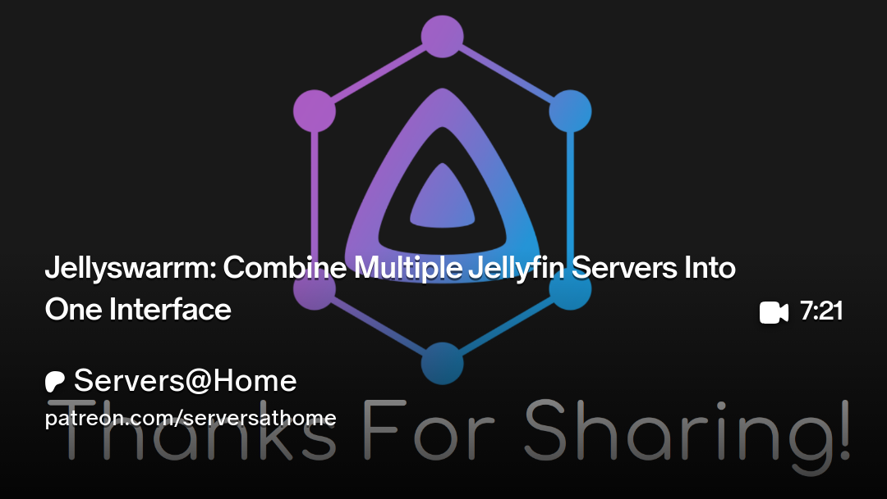

# What is Jellyswarrm?
Jellyswarrm is a reverse proxy that lets you combine multiple Jellyfin servers into one place. If you’ve got libraries spread across different locations or just want everything together, Jellyswarrm makes it easy to access all your media from a single interface.

> [!WARNING]
> For this to work every server must be accessible from Jellyswarrm via LAN, VPN, or FQDN

# :logos:docker-icon: 1 · Deploy Jellyswarrm
```yaml
services:
  jellyswarrm:
    image: ghcr.io/llukas22/jellyswarrm:latest
    container_name: jellyswarrm
    restart: unless-stopped
    ports:
      - 3000:3000
    volumes:
      - /mnt/tank/configs/jellyswarrm:/app/data
    environment:
      - JELLYSWARRM_USERNAME=admin
      - JELLYSWARRM_PASSWORD=jellyswarrm # ⚠️ Change this in production!
```

# 2 · Setup

::block-steps
1. In every Jellyfin server, add all users you wish to have access
1. Navigate to `http://IP:3000/ui` to login to Jellyswarrm
1. Add all of your servers
1. Click **Users** and map your users to every server you want to give them access to
1. Point your Jellyfin client at `http://IP:3000` to access the unified webUI
::

#  3 · Video
[](https://www.patreon.com/posts/jellyswarrm-into-145059441)
