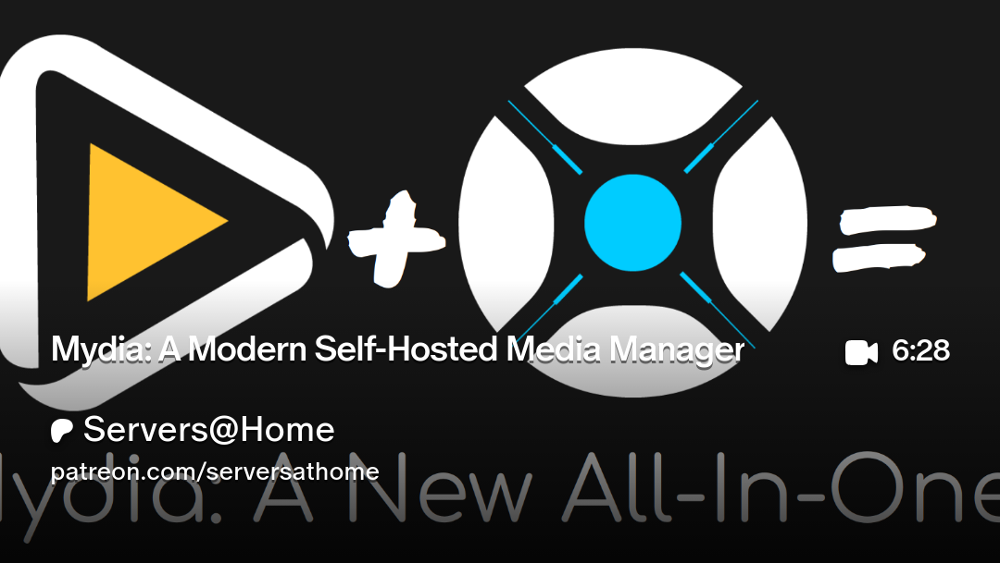

# What is Mydia?
A modern, self-hosted media management platform for tracking, organizing, and monitoring your media library.

# :logos:docker-icon: 1 · Deploy Mydia
```yaml
services:
  mydia:
    image: ghcr.io/getmydia/mydia:latest
    container_name: mydia
    environment:
      - PUID=568
      - PGID=568
      - TZ=America/New_York
      - SECRET_KEY_BASE=your-secret-key-base-here # generate with: openssl rand -base64 48
      - GUARDIAN_SECRET_KEY=your-guardian-secret-key-here # generate a second, different value with: openssl rand -base64 48
      - PHX_HOST=10.99.0.242
      - PORT=4000
      - MOVIES_PATH=/media/movies
      - TV_PATH=/media/tv
    volumes:
      - /mnt/tank/configs/mydia:/config
      - /mnt/tank/media:/media
    ports:
      - 4000:4000
    restart: unless-stopped
```

> [!WARNING]
> Generate two separate secrets (one for `SECRET_KEY_BASE`, one for `GUARDIAN_SECRET_KEY`) by running `openssl rand -base64 48` twice in a shell. Don't reuse the same value for both.

1. Navigate to `http://IP:4000`
1. Create your admin account

#  2 · Video
[](https://www.patreon.com/posts/mydia-modern-143868943)
