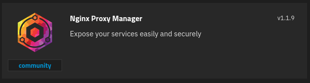
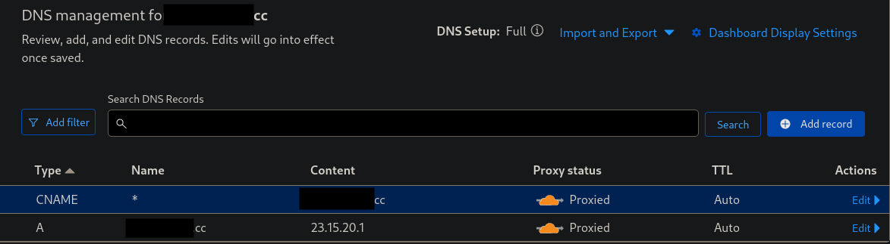
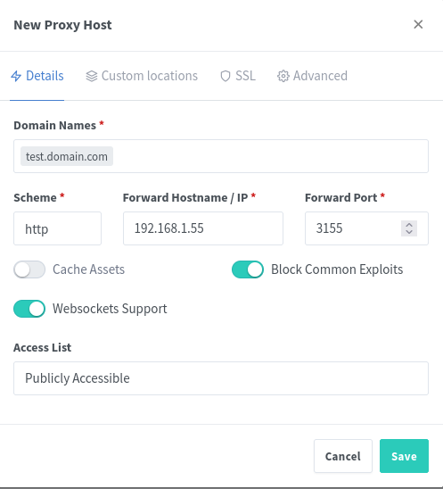
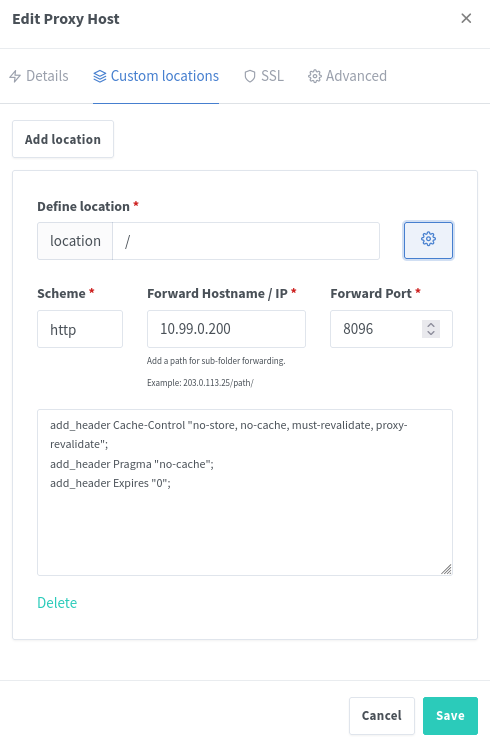
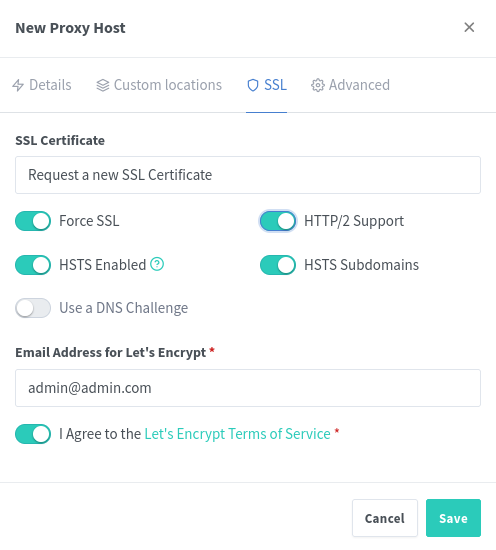
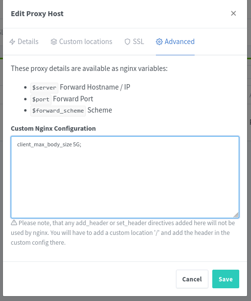

# What is Nginx Proxy Manager?

Nginx Proxy Manager (NPM) is a tool that lets you expose your private web services on your network with free SSL, Docker, and multiple users. You can configure and manage your proxy hosts with a beautiful UI and a simple Docker image.

# 1 · Deploy NPM
:::block-tabs
::block-tab{label="TrueNAS" icon="simple-icons:truenas"}


::block-steps
1. Change the **User ID** and **Group ID** to **0** since Nginx needs to run as root to function.
1. Change the **HTTP Port** to **80** and the **HTTPS Port** to **443**. Choose any port you want for the **WebUI Port** which isn't in use.
1. For the **Nginx Proxy Manager Data Storage** and the **Nginx Proxy Manager Certs Storage** use **Host Path** pointed to a dataset with the correct permissions. 
::

> [!NOTE]
> The dashboard is now deployed on `http://{serverIP}:<WebUI Port>` (the **WebUI Port** you chose in step 2). On first visit the setup wizard asks you to create the admin account. There is no default *admin@example.com* / *changeme* login since v2.13.

::

::block-tab{label="Docker Compose" icon="simple-icons:docker"}
```yaml
services:
 app:
   image: 'jc21/nginx-proxy-manager:latest'
   restart: unless-stopped
   container_name: npm
   ports:
     - '80:80'
     - '81:81'
     - '443:443'
   volumes:
     - /mnt/tank/configs/npm/data:/data
     - /mnt/tank/configs/npm/letsencrypt:/etc/letsencrypt
```

> [!NOTE]
> The dashboard is now deployed on `http://{serverIP}:81`. On first visit the setup wizard asks you to create the admin account. There is no default *admin@example.com* / *changeme* login since v2.13.

> [!WARNING]
> On 32-bit ARM (`armv7`, e.g. older Raspberry Pi OS) use the `jc21/nginx-proxy-manager:2.13.7` tag. Version 2.14+ no longer supports armv7.

::

:::

# 2 · Port Forwarding

In order to reverse proxy your content, you must have ports 80 and 443 properly forwarded to the IP of the host running NPM as well as have a fully qualified domain name (FQDN) DNS entry pointed at the external IP of the router.

# 3 · Domain Name

Whoever manages your domain should have an area for the DNS entries. In order to use nginx properly, we need two records in our DNS table. The first is the A record which points anyone going to example.com to the IP of our server. The second is a CNAME record for \*.example.com which means any subdomain (like cloud.example.com) will also point to the IP address of example.com. The picture below is what this looks like on Cloudflare.



# 4 · Add Proxy Hosts
:::block-tabs
::block-tab{label="Details"}
To setup a reverse proxy to a container, add a proxy host. 

> [!NOTE]
> The screenshots below show the pre-2.13 interface. Newer versions have a redesigned UI, but the same fields.



Add the domain, the internal IP and port number

::

::block-tab{label="Custom Locations"}
In the event you want to edit the headers, that can only be done in Custom Locations. For example, in the event you want to [bypass caching for media servers](https://wiki.serversatho.me/en/Emby#using-npm).



::

::block-tab{label="SSL"}
Now request a new SSL:



You don't have to move these sliders - but it is highly recommended

Done! Now navigate to your site and you are connected via SSL by Let's Encrypt! The certs auto-renew before the 90 days are up so do not worry about updating them manually.

::

::block-tab{label="Advanced"}
Add this line to increase upload limits: `client_max_body_size 5G;`



::

:::

# :logos:youtube-icon: YouTube Walkthrough

::block-youtube{url="https://youtu.be/mvT0Ehz4s8o"}
::
