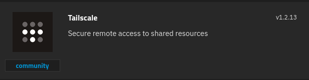

# What is Tailscale?
Tailscale makes creating software-defined networks easy: securely connecting users, services, and devices.

# 1 · Deploy Tailscale
You must first go to [tailscale.com](https://tailscale.com) and click **Get Started**. After you create an account:
1. Navigate to **Settings** ➡ **Keys** ➡ **Auth keys** then click the **Gen Auth Key** button
1. Switch the **Reusable** to **ON**

> [!WARNING]
> Make sure to save the key when it is displayed since it will **not** be displayed again!


:::block-tabs
::block-tab{label="Docker Compose" icon="simple-icons:docker"}
```yaml
services:
  tailscale:
    image: tailscale/tailscale
    restart: unless-stopped
    volumes:
      - /mnt/tank/configs/tailscale:/var/lib
      - /dev/net/tun:/dev/net/tun
    environment:
      - TS_AUTHKEY=
      - TS_ROUTES=192.168.1.0/24
      - TS_STATE_DIR=/var/lib/tailscale
      - TS_EXTRA_ARGS=--advertise-exit-node
      - TS_USERSPACE=false
    network_mode: host
    cap_add:
      - NET_ADMIN
      - NET_RAW
```

1. Add your Auth Key from Tailscale 
1. Modify the `TS_ROUTES` for the CIDR address of the TrueNAS Server. For example, if your server is at 192.168.1.20 your CIDR address would be 192.168.1.0/24.

::

::block-tab{label="TrueNAS" icon="simple-icons:truenas"}


1. Add your Auth Key from Tailscale 
1. Check the box to **Authorize Exit Node**
1. Add an **Advertised Route**. This should be the CIDR address of the TrueNAS Server. For example, if your server is at 192.168.1.20 your CIDR address would be 192.168.1.0/24.
1. Change your **Tailscale State Storage** to host path and point it to a dataset which is set with root permissions.

::

:::

# 2 · Tailscale Configuration
1. Go to your Tailscale dashboard @ https://tailscale.com
1. Navigate to **Machines**
1. Find your TrueNAS Server and click the 3 dot menu and select **Disable Key Expiry**

> [!NOTE]
> **To use Tailscale as a Split Tunnel**
> Find your TrueNAS Server and click the 3 dot menu and select **Edit Route** ➡   **Subnet Routes** ➡ check box to advertise

> [!NOTE]
> **To use Tailscale as a Full Tunnel**
> Find your TrueNAS Server and click the 3 dot menu and select **Edit Route** ➡   **Exit Node** ➡ check box to Use as exit node


# :logos:youtube-icon: 3 · Video
::block-youtube{url="https://youtu.be/lajmJtNycgQ"}
::

