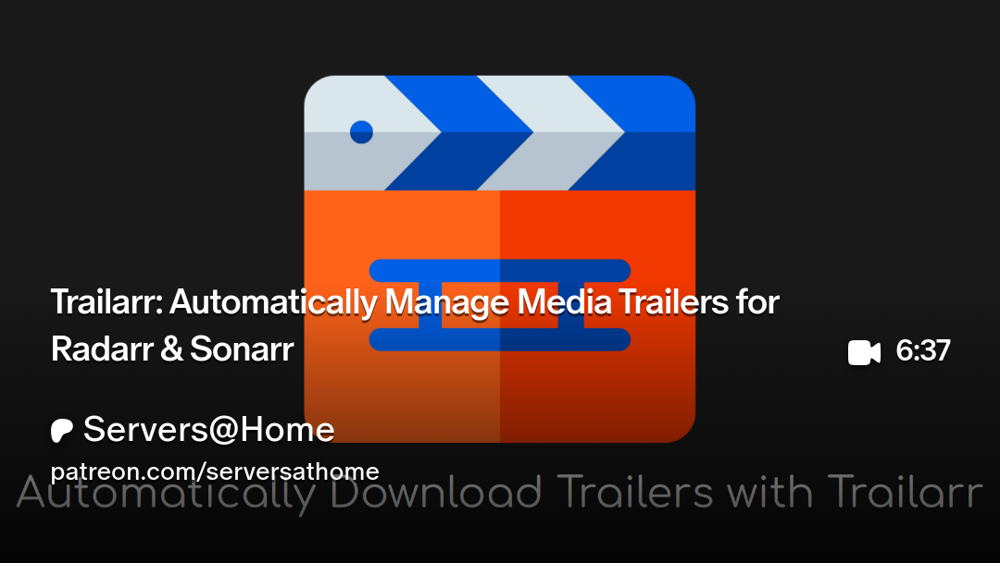

# What is Trailarr?
Trailarr is a Docker application to download and manage trailers for your Radarr, and Sonarr libraries.

# :logos:docker-icon: 1 · Deploy Trailarr

```yaml
services:
  trailarr:
    image: nandyalu/trailarr:latest
    container_name: trailarr
    environment:
      - TZ=America/New_York
    volumes:
      - /mnt/tank/configs/trailarr:/config
      - /mnt/tank/media/movies:/media/movies
      - /mnt/tank/media/tv:/media/tv
    ports:
      - "7889:7889"
    restart: unless-stopped
```

# 2 · Trailarr Configuration

> [!NOTE]
> Default credentials are **admin:trailarr**

## 2.1 Adding Connections

::block-steps
1. Navigate to **Connections** and add your Radarr/Sonarr URL and API Key
1. Change the **Monitor Type** to `Missing`
1. Click **Test**
1. Click the folder icon in the **Path Mappings** seciton and use the default provided path
1. Click **Test** again
1. Click **Submit**
::


#  3 · Video

[](https://www.patreon.com/posts/trailarr-manage-135217577)
