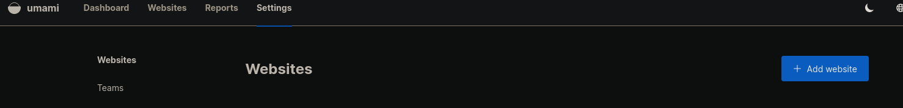
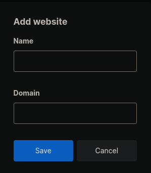
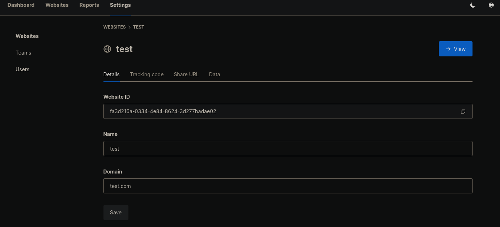

# What is Umami?

Umami is a simple, fast, privacy-focused, open-source analytics solution. Umami is a better alternative to [Google Analytics](https://marketingplatform.google.com/about/analytics/) because it gives you total control of your data and does not violate the privacy of your users.

# 1 · Deploy Umami
:::block-tabs
::block-tab{label="TrueNAS" icon="simple-icons:truenas"}
1. Set a **Database Password**
1. Set an **App Secret**
1. Set the **WebUI Port** to `3002`
1. Set the **Postgres Data Storage** to **Host Path** and select the box for **Automatic Permissions**

::

::block-tab{label="Docker Compose" icon="simple-icons:docker"}
```yaml
services:
 umami:
   image: ghcr.io/umami-software/umami:latest
   container_name: umami
   ports:
     - "3002:3000"
   environment:
     DATABASE_URL: postgresql://umami:umami@db:5432/umami
     APP_SECRET: replace-me-with-a-random-string
     # Required for two-factor authentication, generate with: openssl rand -hex 32
     TWO_FACTOR_ENCRYPTION_KEY: replace-me-with-a-64-character-hex-string
   depends_on:
     db:
       condition: service_healthy
   init: true
   restart: unless-stopped
   healthcheck:
     test: ["CMD-SHELL", "curl http://localhost:3000/api/heartbeat"]
     interval: 5s
     timeout: 5s
     retries: 5
 db:
   image: postgres:15-alpine
   environment:
     POSTGRES_DB: umami
     POSTGRES_USER: umami
     POSTGRES_PASSWORD: umami
   volumes:
     - /mnt/tank/configs/umami:/var/lib/postgresql/data
   restart: unless-stopped
   healthcheck:
     test: ["CMD-SHELL", "pg_isready -U $${POSTGRES_USER} -d $${POSTGRES_DB}"]
     interval: 5s
     timeout: 5s
     retries: 5
```

1. Change the default user names and passwords from the example. 
1. Generate `APP_SECRET` and `TWO_FACTOR_ENCRYPTION_KEY` with `openssl rand -hex 32` (use a different value for each).

::

:::

# 2 · Logging In

1. Navigate to `http://{IP}:3002`. The default username is *admin* and the password is *umami*.

# 3 · Adding Websites

Navigate to **Settings** > **\+ Add Website**.



Name your website. For the domain, omit the `http://`. 



Navigate to **Websites** > then click the **Edit** button next to the site you just added. You will need the *Website ID* to link it to your website, and the *Tracking code* from the next tab.


