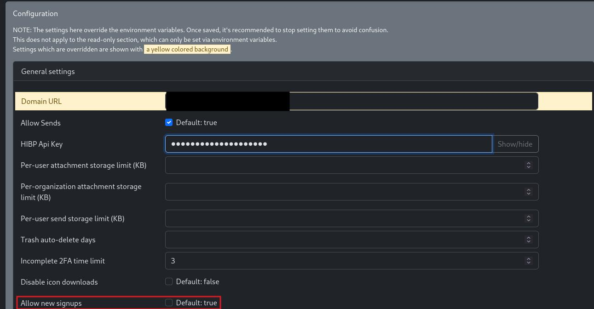

# What is Vaultwarden?

Vaultwarden is a free and secure password manager that works on any device and platform. It is the community version of Bitwarden, with features like organizations, attachments, API, and more.

# 1 · Deploy Vaultwarden
:::block-tabs
::block-tab{label="TrueNAS" icon="simple-icons:truenas"}
1. Set the **Database Password** to something secure
1. Set the **Admin Token** to enable to admin console
1. Set the **Certificate ID** to `truenas_default Certificate`
1. Set the **Vaultwarden Data Storage** to **Host Path**
1. Set the **Vaultwarden Postgres Data Storage** to **Host Path** and select the box for **Automatic Permissions**

::

::block-tab{label="Docker Compose" icon="simple-icons:docker"}
```yaml
services:
  vaultwarden:
    image: vaultwarden/server:latest
    container_name: vaultwarden
    restart: unless-stopped
    ports:
      - 8090:80
    environment:
      DOMAIN: "https://vault.example.com"  # Your domain here!
      # ADMIN_TOKEN: changeme
    volumes:
      - /mnt/tank/configs/vaultwarden:/data
```

> [!NOTE]
> Change the domain to the FQDN with https you will be accessing from. Leave the `admin_token` commented out until you finish the install.

::

:::

# 2 · Logging In

Your Vaultwarden server is now ready on whatever port you specified. However, do not go to http://{localhost}:8090. Even though the page will load you will not be able to create an account. You must come in over https, usually using a reverse proxy like Cloudflare tunnels or Nginx. 

# 3 · Admin Controls

After you have created your account, to prevent other users from doing so on your server, you must disable to ability to create new account from the admin panel. 
1. Generate a hashed admin token with Vaultwarden's built-in generator. It asks for a password (this is what you will type on the admin page) and prints an Argon2 string starting with `$argon2id$`:
   ```bash
   docker exec -it vaultwarden /vaultwarden hash
   ```
1. Go back to your compose file, uncomment the `ADMIN_TOKEN` line, paste the hash in single quotes, and change every `$` to `$$` so compose doesn't treat them as variables. Then relaunch your container
1. Navigate to https://{yourFQDN}.com/admin and uncheck the box that says *Allow new signups*. When you are done, scroll to the bottom and click **Save**
1. Now comment the `ADMIN_TOKEN` line back out and restart the container. 
> [!WARNING]
> To fully disable to Admin panel, you need to remove the line for the admin token from the config.json file within the container.

> [!NOTE]
> A plain-text `ADMIN_TOKEN` still works, but Vaultwarden logs a warning that it is insecure. Use the hash from `vaultwarden hash` instead. See the [admin page docs](https://github.com/dani-garcia/vaultwarden/wiki/Enabling-admin-page).

> [!NOTE]
> Prefer to skip the admin panel? Add `SIGNUPS_ALLOWED: "false"` under `environment:` after you have created your account and restart the container. New sign-ups are then turned off.




# :logos:youtube-icon: 4 · Video

::block-youtube{url="https://www.youtube.com/watch?v=DqNZO6n8Wqc"}
::

